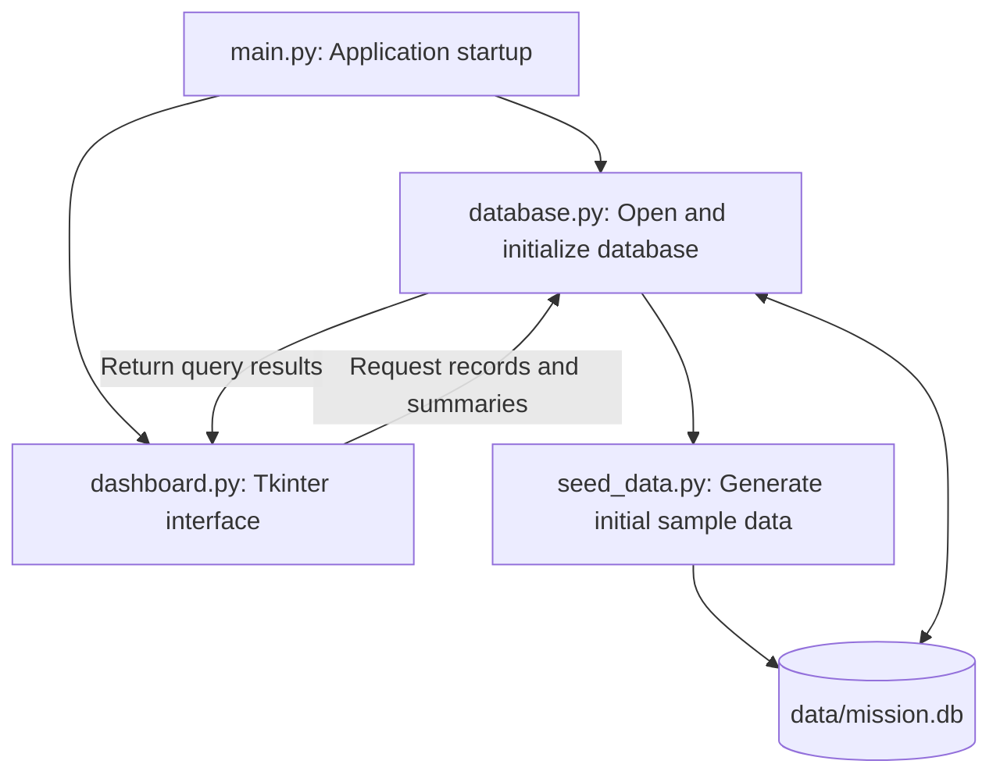

# SomaiyaSat Mission Data Dashboard

A Python desktop application for displaying satellite health readings, communication records, and deployment events for the SomaiyaSat and SomaiyaPod use case. It uses synthetic mission data stored locally in SQLite and presents it through a Tkinter interface.

## Architecture

The application separates the interface, database operations, and sample data generation into individual Python modules.

`main.py` opens the database and passes the connection to the dashboard. Button clicks call Python methods that retrieve data through `database.py` and update the displayed widgets. Everything runs locally in one process using Tkinter's event loop.

## Project structure

| File | Responsibility |
| --- | --- |
| `main.py` | Creates the application window, opens the database, starts the event loop, and closes the connection on exit |
| `dashboard.py` | Contains the `Dashboard` class, screen navigation, table widgets, filters, status cards, and battery chart |
| `database.py` | Creates tables, validates date filters, executes SQL queries, and calculates summary values |
| `seed_data.py` | Generates and inserts synthetic records during initial database setup |
| `data/mission.db` | Stores the records between application runs |
| `tests/test_database.py` | Checks database setup, persistence, filtering, constraints, and calculations using temporary databases |

## Interface structure

The interface has three frames inside one window. Navigation buttons switch between them.

| Screen | Contents |
| --- | --- |
| Overview | Latest battery level, temperature, link score, operating mode, pending records, transmission success rate, latest event, and battery history |
| Telemetry | A table of health readings with start and end date filters |
| Communication & Events | Communication records filtered by mode or status, a deployment event table, and notes for selected rows |

Tables use `ttk.Treeview`, while the battery chart is drawn using `tkinter.Canvas`. Tkinter variables connect summary values and filter inputs to the interface. The current interface supports viewing and filtering stored records.

## Database structure

SQLite stores the data in three tables. Each table has an integer primary key. The application covers one satellite and deployer pair, so the tables do not require a separate satellite registry or foreign-key relationships.

| Table | Main fields |
| --- | --- |
| `telemetry` | `id`, `recorded_at`, `battery_pct`, `temperature_c`, `link_quality_pct`, `operating_mode` |
| `communication_records` | `id`, `created_at`, `mode`, `size_kb`, `status`, `notes` |
| `mission_events` | `id`, `occurred_at`, `component`, `event_name`, `outcome`, `notes` |

Timestamps are stored as text in `YYYY-MM-DD HH:MM:SS` format and displayed as UTC. Required fields use `NOT NULL`; `CHECK` constraints restrict battery and link scores, record sizes, and allowed modes and statuses. Filter values are supplied through SQL placeholders.

## Data flow

1. On startup, the application opens `data/mission.db` and creates the tables if needed.
2. During initial setup, `seed_data.py` inserts 200 telemetry readings, 80 communication records, and six mission events. Later launches reuse the saved records.
3. When a screen is opened or a filter is applied, the dashboard calls the corresponding database function.
4. The database returns matching rows or summary values, which the dashboard displays in labels, tables, and the chart.
5. Closing the application ends the event loop and closes the database connection.

Telemetry is displayed newest first. Communication records are ordered by priority, then creation time: TT&C has priority 1, SSTV has priority 2, and Codec2/M17 have priority 3. Priority is calculated from the mode rather than stored separately.

Transmission success rate is calculated as `sent / (sent + failed) * 100`. Pending records are excluded, and the interface displays `N/A` when there are no attempted transmissions.

## Data and technology

The project uses Python's `sqlite3`, `tkinter`, `random`, `datetime`, and `pathlib` modules, with `unittest` for database tests. No third-party Python packages are required.

Sample data is generated with a fixed random seed and covers 15-16 January 2026. The readings, events, link score, and 20% battery threshold are illustrative. The application demonstrates the data-display component of use case KJS-SRS-01; it does not connect to satellite hardware or perform AI-based routing.
